# Writing messages with the bee — pressure test

9 November 2026 · branch `glass-sidebar` · model **OpenAI GPT-6.1 Sol** (the product's only model), through the app's own pipeline: the facts of the matter with the words of what came in, everything disguised, the answer restored. Only the demo's invented matters were sent — no real names, no real mail.

**How it was run.** `matter-spike pressure` asks each question exactly as the chat does (same facts, same rules, same disguise), and records what the bee was given, what went out, and what came back. Four rounds: round 1 on the code as it was, rounds 2–4 after each set of fixes below. The screenshots show the round-4 answers drawn by the iPhone app (demo, `-answers.recorded`).

## What the test found, and what was changed

| # | Found in round 1 | Cause | Fixed by | Round 4 |
|---|---|---|---|---|
| 1 | The recipient shown as a stand-in: “[Person B]”, “Ms. [Person C]”, “Registry Office [Place A]” | The card's `party` was never restored | `party` restored like every other field | none left |
| 2 | Subjects garbled: “care level **For** Helga **Mara** Voss”, “Parking **For** the van?” | “For” learned as a company; “Voss” (part of the owner's name) disguised Helga's surname as the owner | Single common words are never names (old lists forget them); a surname after another first name is noted before disguising and comes back as itself | clean |
| 3 | A change asked of a draft ignored: “unterschreib nur mit Mara” gave the same text | The earlier draft was sent to the bee cut at 80 characters; no rule said a change must change it | Earlier drafts go whole; rule: the same draft with exactly that change, same recipient and subject | applied |
| 4 | Every reply “Hello, … Best regards, Mara Voss”, even to a close friend | The demo's mails were all written “Hello … Best regards”, so mirroring them was right — the test data was wrong | Demo senders write in their own voices: friends “Hi Mara! … See you soon”, firms “Hello Ms Voss … Kind regards”, offices “Dear Ms Voss … Yours sincerely” | mirrored |
| 5 | The same reply in German once, in English once | No rule on which language | Rule: the language of the exchange, unless the owner names one | consistent |
| 6 | “Mum is home from Monday” written to the care fund | The owner's shorthand copied | Rule: shorthand made clear to the reader (“my mother, Helga Voss”), with what identifies the case | applied |
| 7 | (round 2) “Hello Autohaus Weber”, “Hello Trattoria Lume” | No rule on how to greet a firm | Rule: a firm without a person is greeted without a name | “Hello,” |
| 8 | (round 2) A follow-up draft lost its recipient | — | Rule: same recipient and subject when changing a draft | kept |
| 9 | (round 3) Still “Hi Tomás Ribeiro!”, “Hello Priya Raman” | The bee only ever sees a person as one tag for the whole name — it cannot write a first name alone | The bee writes `[Person A·first]` / `[Person A·last]`; the device puts in the first name or surname. No name leaves the device | “Hi Tomás!”, “Hello Mr Lindqvist” |

Each rule is in `AssistantPrompt` ("How the owner writes") and in the manifesto, principle 13. The disguise fixes have tests: `DisguiseFindingsTests`.

## The cases

### 01 · Car buyer, casual dealer

**Matter:** Volvo or VW — next car · **In hand:** “Test drive ID.3”

**You:** Antworte: Freitag passt

<details><summary>What the bee was given about the mail in hand</summary>

```
E1 2026-11-07 from Autohaus Weber: Test drive ID.3 — A test drive of the ID.3 is possible on Saturday at 10:00. — its words: "Hello Ms Voss, / A test drive of the ID.3 is possible on Saturday at 10:00. / Kind regards, / Autohaus Weber" — written: opens "Hello Ms Voss,", closes "Kind regards, / Autohaus Weber"
```
</details>

*Went out disguised as:* `Antworte: Freitag passt`

**Mail draft** · Subject: Re: Test drive ID.3

```
Hello,

Friday works.

Kind regards,
Mara Voss
```
*Why, as the bee says:* Antwort auf die Terminanfrage wie gewünscht.

Checks: Their mail opens “Hello Ms Voss,”, closes “Kind regards, / Autohaus Weber” — the draft opens “Hello,”, closes “Kind regards, / Mara Voss”. Language: theirs English, the draft English. Stand-ins left: none. Goes to: Autohaus Weber — VW dealer (in 1 items). Length: 7 words.

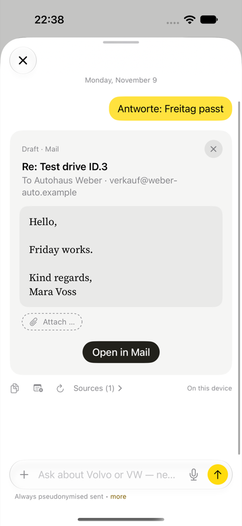

*6 s · $0.012*

<details><summary>Round 1, for comparison</summary>

```
Hallo,

Freitag passt.

Viele Grüße
Mara Voss
```
</details>

### 02 · Car buyer, follow-up

**Matter:** Volvo or VW — next car · **In hand:** “Test drive ID.3”

**You:** Schreib dem Autohaus, dass Freitag passt

<details><summary>What the bee was given about the mail in hand</summary>

```
E1 2026-11-07 from Autohaus Weber: Test drive ID.3 — A test drive of the ID.3 is possible on Saturday at 10:00. — its words: "Hello Ms Voss, / A test drive of the ID.3 is possible on Saturday at 10:00. / Kind regards, / Autohaus Weber" — written: opens "Hello Ms Voss,", closes "Kind regards, / Autohaus Weber"
```
</details>

*Went out disguised as:* `Schreib dem Autohaus, dass Freitag passt`

**Mail draft** · Subject: Re: Test drive ID.3

```
Hello,

Friday works for me.

Kind regards,
Mara Voss
```
*Why, as the bee says:* Antwort im bestehenden Mailwechsel mit dem Autohaus.

Checks: Their mail opens “Hello Ms Voss,”, closes “Kind regards, / Autohaus Weber” — the draft opens “Hello,”, closes “Kind regards, / Mara Voss”. Language: theirs English, the draft English. Stand-ins left: none. Goes to: Autohaus Weber — VW dealer (in 1 items). Length: 9 words.

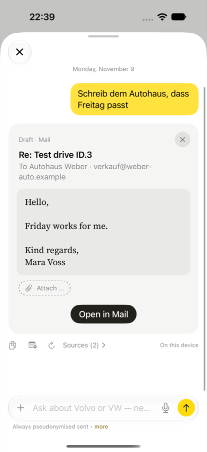

*7 s · $0.005*

**You:** kürzer bitte, und sag, ich bringe meine Frau mit

*Went out disguised as:* `kürzer bitte, und sag, ich bringe meine Frau mit`

**Mail draft** · Subject: Re: Test drive ID.3

```
Hello,

Friday works. My wife is coming too.

Kind regards,
Mara Voss
```
*Why, as the bee says:* Kürzt den Entwurf und ergänzt, dass deine Frau mitkommt.

Checks: Their mail opens “Hello Ms Voss,”, closes “Kind regards, / Autohaus Weber” — the draft opens “Hello,”, closes “Kind regards, / Mara Voss”. Language: theirs English, the draft English. Stand-ins left: none. Goes to: Autohaus Weber — VW dealer (in 1 items). Length: 12 words.

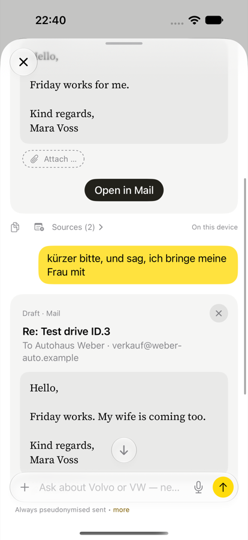

*7 s · $0.005*

<details><summary>Round 1, for comparison</summary>

```
Hallo,

Freitag passt.

Viele Grüße
Mara Voss
```
```
Hallo,

Freitag passt, ich bringe meine Frau mit.

Viele Grüße
Mara Voss
```
</details>

### 03 · Car buyer, WhatsApp

**Matter:** Volvo or VW — next car · nothing in hand

**You:** WhatsApp an meine Frau: Probefahrt Freitag, kommst du mit?

*Went out disguised as:* `WhatsApp an meine Frau: Probefahrt Freitag, kommst du mit?`

**Short message**

```
Probefahrt Freitag, kommst du mit?
```
*Why, as the bee says:* Fragt deine Frau, ob sie zur Probefahrt mitkommt.

Checks: Stand-ins left: none. Goes to: — none —. Length: 5 words.

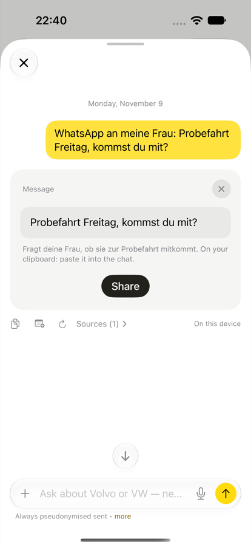

*7 s · $0.004*

<details><summary>Round 1, for comparison</summary>

```
Probefahrt Freitag, kommst du mit?
```
</details>

### 04 · Busy parent, sister

**Matter:** Care for Mum (Helga) after her fall · **In hand:** “Who does what this week”

**You:** Antworte Mara: ich übernehme Dienstag und Donnerstag, Freitag kann ich nicht

<details><summary>What the bee was given about the mail in hand</summary>

```
E10 2026-10-01 from Mara Voss: Re: Who does what this week? — Mara can take Monday and Tuesday this week and will ask Uncle Karl about Thursday. — its words: "Hi everyone, / Mara can take Monday and Tuesday this week and will ask Uncle Karl about Thursday. / Mara" — written: opens "Hi everyone,", closes "Mara"
```
</details>

*Went out disguised as:* `Antworte [Place A]: ich übernehme Dienstag und Donnerstag, Freitag kann ich nicht`

> Entwurf an Nina Voss: Dienstag und Donnerstag übernimmst du, Freitag kannst du nicht.  [E11 P3]

**Mail draft** · Subject: Re: Who does what this week?

```
Hi Nina,

I’ll take Tuesday and Thursday. I can’t do Friday.

Mara
```
*Why, as the bee says:* Antwort auf die geöffnete Mail zur Aufteilung der Betreuung.

Checks: Their mail opens “Hi everyone,”, closes “Mara” — the draft opens “Hi Nina,”, closes “I’ll take Tuesday and Thursday. I can’t do Friday. / Mara”. Language: theirs English, the draft English. Stand-ins left: none. Goes to: Nina Voss — Sister, shares the care (in 3 items). Length: 12 words.

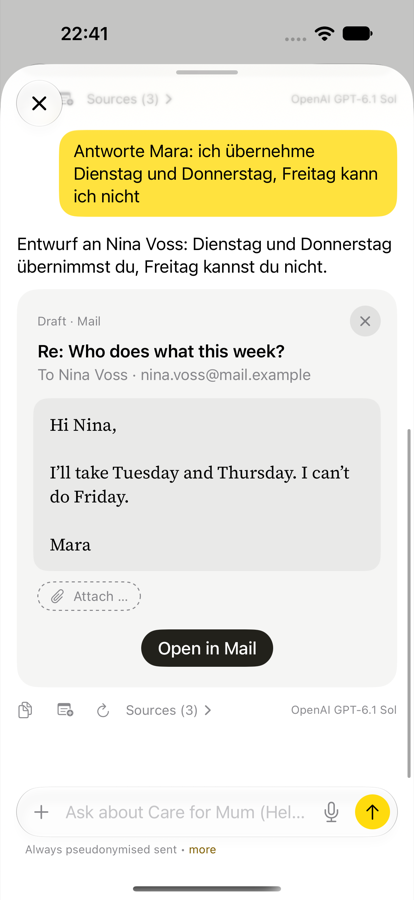

*14 s · $0.012*

<details><summary>Round 1, for comparison</summary>

```
Hallo,

ich übernehme Dienstag und Donnerstag, Freitag kann ich nicht.

Viele Grüße
Mara Voss
```
</details>

### 05 · Busy parent, care fund (formal office)

**Matter:** Care for Mum (Helga) after her fall · **In hand:** “Application received”

**You:** Write to the care fund: when will the assessor come? Mum is home from Monday.

<details><summary>What the bee was given about the mail in hand</summary>

```
E8 2026-10-10 from Healthbridge Care Fund: Application received: care level for Helga Voss — The application arrived. The insurer decides within 25 working days. A visit by the medical service will be arranged. — its words: "Dear Ms Voss, / The application arrived. The insurer decides within 25 working days. A visit by the medical service will be arranged. / Yours sincerely, / Healthbridge Care Fund" — written: opens "Dear Ms Voss,", closes "Yours sincerely, / Healthbridge Care Fund"
```
</details>

*Went out disguised as:* `Write to the care fund: when will the assessor come? Mum is home from Monday.`

**Mail draft** · Subject: Assessment visit for Helga Voss

```
Dear Sir or Madam,

When will the assessor come to see my mother, Helga Voss? She will be home from Monday.

Yours sincerely,
Mara Voss
```
*Why, as the bee says:* Asks when the assessor will come and says Mum will be home from Monday.

Checks: Their mail opens “Dear Ms Voss,”, closes “Yours sincerely, / Healthbridge Care Fund” — the draft opens “Dear Sir or Madam,”, closes “Yours sincerely, / Mara Voss”. Language: theirs English, the draft English. Stand-ins left: none. Goes to: Healthbridge Care Fund — Health insurer (in 3 items). Greeting by first and last name — not as people write. Length: 25 words.

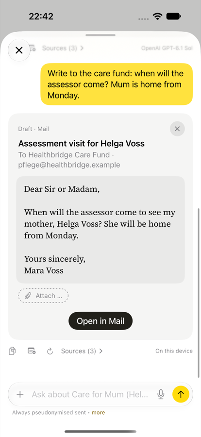

*10 s · $0.010*

<details><summary>Round 1, for comparison</summary>

```
Hello,

When will the assessor come? Mum is home from Monday.

Best regards,
Mara Voss
```
</details>

### 06 · Busy parent, physio

**Matter:** Care for Mum (Helga) after her fall · **In hand:** “Physio appointments”

**You:** Sag der Physio ab für Donnerstag, Mama hat einen Arzttermin

<details><summary>What the bee was given about the mail in hand</summary>

```
E6 2026-10-22 from Anja Bergmann: Physio appointments for Helga — Helga has physiotherapy on Tuesdays and Fridays at 11:00, starting Friday 2 October. — its words: "Hello Ms Voss, / Helga has physiotherapy on Tuesdays and Fridays at 11:00, starting Friday 2 October. / Kind regards, / Anja Bergmann" — written: opens "Hello Ms Voss,", closes "Kind regards, / Anja Bergmann"
```
</details>

*Went out disguised as:* `Sag der Physio ab für Donnerstag, Mama hat einen Arzttermin`

> Meinst du den eingetragenen Termin am Dienstag, 10. November, um 11:00 Uhr oder einen zusätzlichen Termin am Donnerstag?  [A1 E6]

No card: the bee asked first — a draft guesses nothing it is not given.

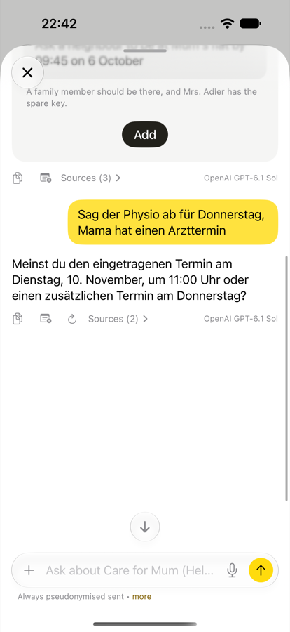

*14 s · $0.011*

### 07 · Busy parent, unknown recipient

**Matter:** Care for Mum (Helga) after her fall · nothing in hand

**You:** Schreib eine Mail an die neue Pflegerin, dass sie den Schlüssel bei der Nachbarin holen kann

*Went out disguised as:* `Schreib eine Mail an die neue Pflegerin, dass sie den Schlüssel bei der Nachbarin holen kann`

> Wie heißt die neue Pflegerin?

No card: the bee asked first — a draft guesses nothing it is not given.

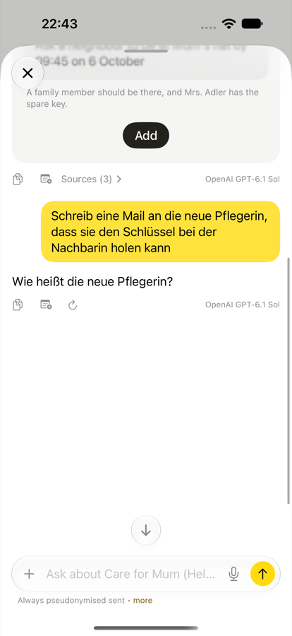

*5 s · $0.008*

### 08 · Homeowner, owners' group (many)

**Matter:** New property manager for Elm Court 51 · nothing in hand

**You:** Schreib an alle Eigentümer: Abstimmung über Kessler bis Sonntag, bitte im Chat antworten

*Went out disguised as:* `Schreib an alle Eigentümer: Abstimmung über Kessler bis Sonntag, bitte im Chat antworten`

> Nachricht an die Eigentümergruppe: Abstimmung bis Sonntag, Antwort im Chat.  [E2]

**Short message**

```
Please reply in the chat with your vote on Kessler by Sunday.
```
*Why, as the bee says:* Die Eigentümergruppe bespricht die Abstimmung über Kessler.

Checks: Stand-ins left: none. Goes to: elm court owners. Length: 12 words.

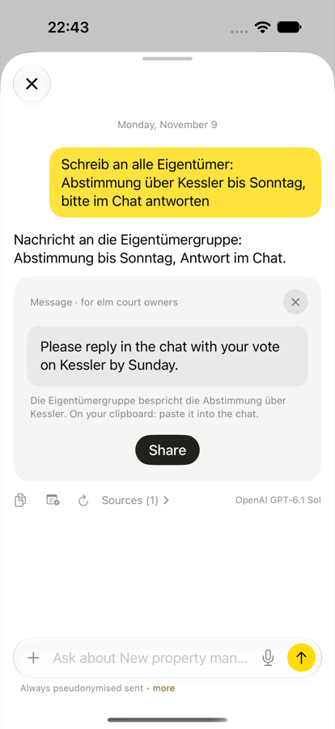

*10 s · $0.007*

<details><summary>Round 1, for comparison</summary>

```
Bitte stimmt bis Sonntag über Kessler ab und antwortet hier im Chat.
```
</details>

### 09 · Homeowner, old manager (formal)

**Matter:** New property manager for Elm Court 51 · **In hand:** “Handover of the building documents”

**You:** Antworte Hartmann: bitte alle Unterlagen bis 15.12. an Kessler übergeben, Liste kommt separat

<details><summary>What the bee was given about the mail in hand</summary>

```
E3 2026-10-31 from Hartmann Immobilien: Handover of the building documents — Hartmann will hand over the files on 31 December. The 2025 statement follows in February. — its words: "Hello Ms Voss, / Hartmann will hand over the files on 31 December. The 2025 statement follows in February. / Kind regards, / Hartmann Immobilien" — written: opens "Hello Ms Voss,", closes "Kind regards, / Hartmann Immobilien"
```
</details>

*Went out disguised as:* `Antworte [Person F]: bitte alle Unterlagen bis 15.12. an Kessler übergeben, Liste kommt separat`

> Entwurf auf Englisch: alle Unterlagen bis 15. Dezember an Kessler; die Liste folgt separat.  [E3]

**Mail draft** · Subject: Re: Handover of the building documents

```
Hello,

Please hand over all documents to Kessler by 15 December. The list will follow separately.

Kind regards,
Mara Voss
```
*Why, as the bee says:* Antwort auf die Übergabeankündigung mit deinem gewünschten Termin und Hinweis auf die separate Liste.

Checks: Their mail opens “Hello Ms Voss,”, closes “Kind regards, / Hartmann Immobilien” — the draft opens “Hello,”, closes “Kind regards, / Mara Voss”. Language: theirs English, the draft English. Stand-ins left: none. Goes to: Hartmann Immobilien — Current property manager (in 2 items). Length: 20 words.

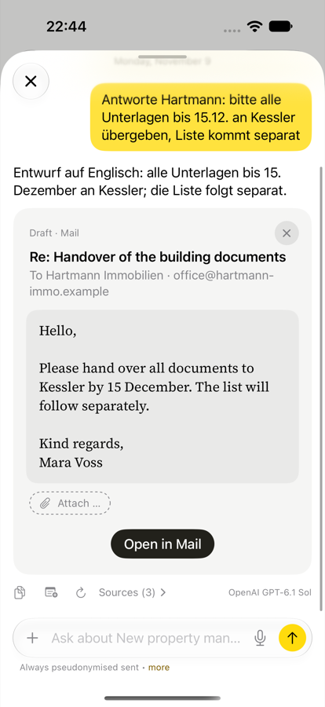

*6 s · $0.006*

<details><summary>Round 1, for comparison</summary>

```
Hallo,

bitte übergeben Sie alle Unterlagen bis zum 15. Dezember an Kessler. Die Liste kommt separat.

Viele Grüße
Mara Voss
```
</details>

### 10 · Homeowner, attach the photo

**Matter:** New property manager for Elm Court 51 · nothing in hand

**You:** Mail an Kessler mit dem Foto vom Aushang im Treppenhaus, sie sollen das bitte aktualisieren

*Went out disguised as:* `Mail an Kessler mit dem Foto vom Aushang im Treppenhaus, sie sollen das bitte aktualisieren`

> Die Mail bittet Kessler um Aktualisierung des Aushangs; das Foto ist angehängt.  [E1 E5 F1]

**Mail draft** · Subject: Owners’ meeting – stairwell notice

```
Hello,

Please update the attached stairwell notice for the owners’ meeting.

Kind regards,
Mara Voss
```
*Why, as the bee says:* Kessler soll den fotografierten Aushang aktualisieren.

Checks: Stand-ins left: none. Goes to: Kessler Hausverwaltung — New property manager (in 3 items). Takes along: Photo 4.jpg. Length: 15 words.

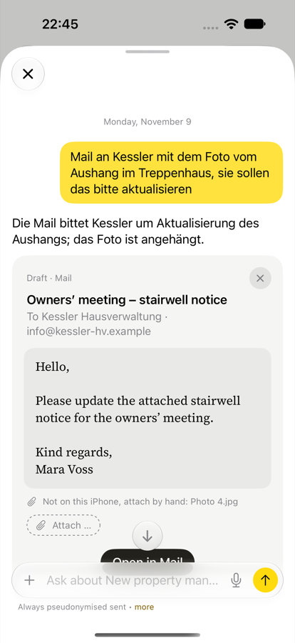

*8 s · $0.006*

<details><summary>Round 1, for comparison</summary>

```
Hallo,

bitte aktualisieren Sie den Aushang im Treppenhaus. Das Foto finden Sie im Anhang.

Viele Grüße
Mara Voss
```
</details>

### 11 · Job applicant, recruiter in English

**Matter:** Application: Head of Design, Brightwave · **In hand:** “Second interview at Brightwave”

**You:** Reply: Tuesday at 10 works, looking forward

<details><summary>What the bee was given about the mail in hand</summary>

```
E2 2026-11-02 from Priya Raman: Second interview at Brightwave — Priya invites Mara to a second interview with the CPO on Thursday at 14:00, with a 20-minute case study on a design system. — its words: "Hello Ms Voss, / Priya invites Mara to a second interview with the CPO on Thursday at 14:00, with a 20-minute case study on a design system. / Kind regards, / Priya Raman" — written: opens "Hello Ms Voss,", closes "Kind regards, / Priya Raman"
```
</details>

*Went out disguised as:* `Reply: Tuesday at 10 works, looking forward`

**Mail draft** · Subject: Re: Second interview at Brightwave

```
Hello,

Tuesday at 10 works. Looking forward to it.

Kind regards,
Mara Voss
```
*Why, as the bee says:* Reply to the recruiter with your requested time and wording.

Checks: Their mail opens “Hello Ms Voss,”, closes “Kind regards, / Priya Raman” — the draft opens “Hello,”, closes “Kind regards, / Mara Voss”. Language: theirs English, the draft English. Stand-ins left: none. Goes to: Priya Raman — Recruiter, Brightwave (in 2 items). Length: 13 words.

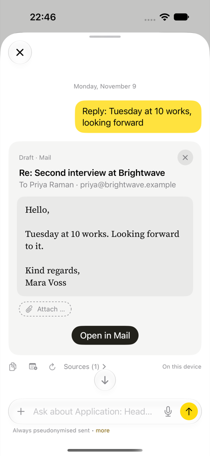

*12 s · $0.007*

<details><summary>Round 1, for comparison</summary>

```
Hello,

Tuesday at 10 works. Looking forward to it.

Best regards,
Mara Voss
```
</details>

### 12 · Job applicant, attach CV

**Matter:** Application: Head of Design, Brightwave · nothing in hand

**You:** Send Priya my CV and portfolio again, she asked for the latest version

*Went out disguised as:* `Send [Person G] my CV and portfolio again, she asked for the latest version`

> What portfolio link should I include?
> *Not in the facts:* The facts mention the previously sent portfolio link but do not contain the link itself.

No card: the bee asked first — a draft guesses nothing it is not given.

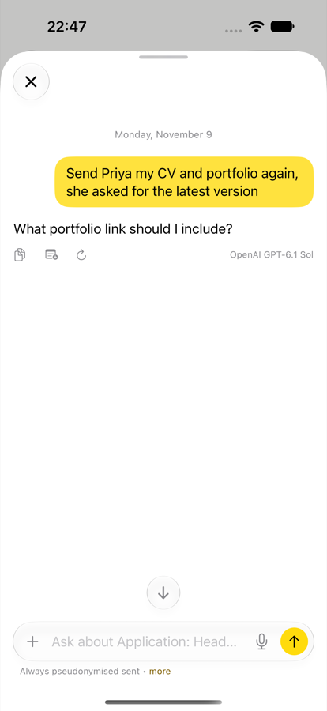

*6 s · $0.004*

### 13 · Job applicant, salary (tone)

**Matter:** Application: Head of Design, Brightwave · **In hand:** “Second interview at Brightwave”

**You:** Antworte, dass ich vor dem Gespräch gern über das Gehaltsband sprechen würde

<details><summary>What the bee was given about the mail in hand</summary>

```
E2 2026-11-02 from Priya Raman: Second interview at Brightwave — Priya invites Mara to a second interview with the CPO on Thursday at 14:00, with a 20-minute case study on a design system. — its words: "Hello Ms Voss, / Priya invites Mara to a second interview with the CPO on Thursday at 14:00, with a 20-minute case study on a design system. / Kind regards, / Priya Raman" — written: opens "Hello Ms Voss,", closes "Kind regards, / Priya Raman"
```
</details>

*Went out disguised as:* `Antworte, dass ich vor dem Gespräch gern über das Gehaltsband sprechen würde`

> Der Entwurf bittet darum, das Gehaltsband vor dem Gespräch zu besprechen.  [E1 E2]

**Mail draft** · Subject: Re: Second interview at Brightwave

```
Hello,

I'd like to discuss the salary range before the interview.

Kind regards,
Mara Voss
```
*Why, as the bee says:* Antwort auf die Einladung; das Gehaltsband ist noch offen.

Checks: Their mail opens “Hello Ms Voss,”, closes “Kind regards, / Priya Raman” — the draft opens “Hello,”, closes “Kind regards, / Mara Voss”. Language: theirs English, the draft English. Stand-ins left: none. Goes to: Priya Raman — Recruiter, Brightwave (in 2 items). Length: 15 words.

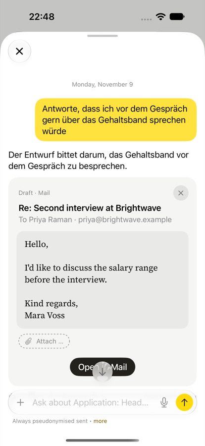

*8 s · $0.006*

<details><summary>Round 1, for comparison</summary>

```
Hello,

I'd like to discuss the salary range before the interview.

Best regards,
Mara Voss
```
</details>

### 14 · Traveler, host in Portugal (language)

**Matter:** Lisbon, 17–24 October (family trip) · **In hand:** “Arrival time”

**You:** Sag Marta, wir kommen erst um 23 Uhr an, Flug wurde verschoben

<details><summary>What the bee was given about the mail in hand</summary>

```
E1 2026-11-08 from Marta Sousa: Re: Arrival time? — Marta asks again for the arrival time. She travels on Friday and wants to arrange the key box before. — its words: "Hello Ms Voss, / Marta asks again for the arrival time. She travels on Friday and wants to arrange the key box before. / Kind regards, / Marta Sousa" — written: opens "Hello Ms Voss,", closes "Kind regards, / Marta Sousa"
```
</details>

*Went out disguised as:* `Sag [Person H], wir kommen erst um 23 Uhr an, Flug wurde verschoben`

> Der Entwurf nennt eure Ankunft erst um 23 Uhr wegen der Flugverschiebung.  [E3 E5]

**Mail draft** · Subject: Re: Arrival time? Key box and tram tips

```
Hello Ms Sousa,

We won't arrive until 23:00, as our flight has been rescheduled.

Kind regards,
Mara Voss
```
*Why, as the bee says:* Antwort auf die Frage nach eurer Ankunft, mit deiner Angabe zur Flugverschiebung.

Checks: Their mail opens “Hello Ms Voss,”, closes “Kind regards, / Marta Sousa” — the draft opens “Hello Ms Sousa,”, closes “Kind regards, / Mara Voss”. Language: theirs English, the draft English. Stand-ins left: none. Goes to: Marta Sousa — Host of the apartment (in 3 items). Greeting by first and last name — not as people write. Length: 18 words.

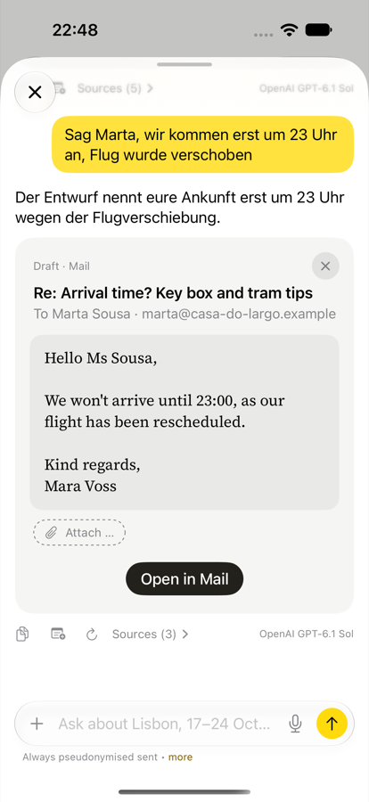

*7 s · $0.009*

<details><summary>Round 1, for comparison</summary>

```
Hello,

We won't arrive until 23:00 because our flight has been rescheduled.

Best regards,
Mara Voss
```
</details>

### 15 · Traveler, friend dinner

**Matter:** Lisbon, 17–24 October (family trip) · **In hand:** “Dinner at mine”

**You:** Reply to Tomás: yes we come, can we bring the kids?

<details><summary>What the bee was given about the mail in hand</summary>

```
E7 2026-10-14 from Tomás Ribeiro: You are coming!! Dinner at mine? — Tomás lives in Alfama and invites the family to dinner on Tuesday 20 October. He will send the address and the door code. — its words: "Hi Mara! / Tomás lives in Alfama and invites the family to dinner on Tuesday 20 October. He will send the address and the door code. / See you soon, / Tomás" — written: opens "Hi Mara!", closes "See you soon, / Tomás"
```
</details>

*Went out disguised as:* `Reply to [Person I]: yes we come, can we bring the kids?`

> The reply says you’re coming and asks whether you can bring the kids.  [E7]

**Mail draft** · Subject: Re: You are coming!! Dinner at mine?

```
Hi Tomás!

Yes, we’re coming! Can we bring the kids?

See you soon,
Mara
```
*Why, as the bee says:* Replies to Tomás Ribeiro’s dinner invitation.

Checks: Their mail opens “Hi Mara!”, closes “See you soon, / Tomás” — the draft opens “Hi Tomás!”, closes “See you soon, / Mara”. Language: theirs English, the draft English. Stand-ins left: none. Goes to: Tomás Ribeiro — Friend in Lisbon (in 1 items). Length: 14 words.

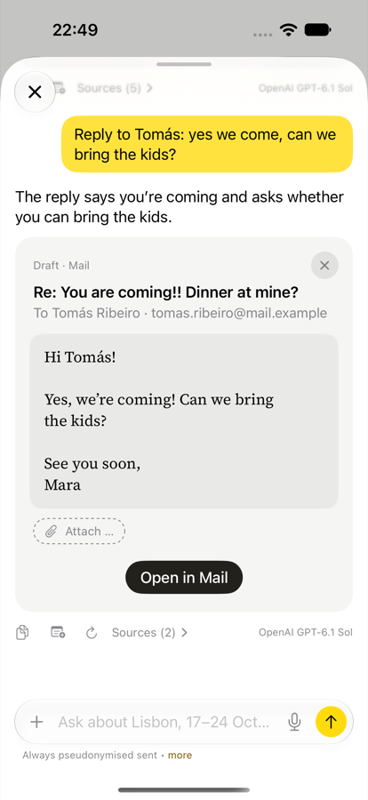

*7 s · $0.009*

**You:** make it warmer, he is a close friend

*Went out disguised as:* `make it warmer, he is a close friend`

> A warmer reply, still asking whether you can bring the kids.  [E7]

**Mail draft** · Subject: Re: You are coming!! Dinner at mine?

```
Hi Tomás!

Yes, we’d love to come! Can we bring the kids?

Can’t wait to see you!
Mara
```
*Why, as the bee says:* Keeps the acceptance and question about the kids, with a warmer tone for your close friend.

Checks: Their mail opens “Hi Mara!”, closes “See you soon, / Tomás” — the draft opens “Hi Tomás!”, closes “Can’t wait to see you! / Mara”. Language: theirs English, the draft English. Stand-ins left: none. Goes to: Tomás Ribeiro — Friend in Lisbon (in 1 items). Length: 18 words.

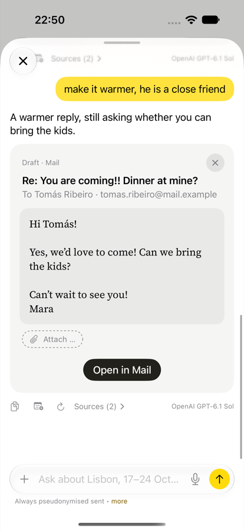

*9 s · $0.009*

<details><summary>Round 1, for comparison</summary>

```
Hello,

Yes, we're coming! Can we bring the kids?

Best regards,
Mara Voss
```
```
Hello Tomás Ribeiro,

Yes, we'd love to come! It'll be lovely to see you. Can we bring the kids?

Best regards,
Mara Voss
```
</details>

### 16 · Accident, insurer (formal, bank details)

**Matter:** Parking-lot accident, 14 September · **In hand:** “Please confirm your bank details”

**You:** Antworte der Versicherung, die Bankverbindung stimmt, und frag nach dem Stand

<details><summary>What the bee was given about the mail in hand</summary>

```
E1 2026-11-08 from Sabine Ott: Please confirm your bank details — For the payment, please confirm the account holder and the IBAN. — its words: "Dear Ms Voss, / For the payment, please confirm the account holder and the IBAN. / Yours sincerely, / Sabine Ott" — written: opens "Dear Ms Voss,", closes "Yours sincerely, / Sabine Ott"
```
</details>

*Went out disguised as:* `Antworte der Versicherung, die Bankverbindung stimmt, und frag nach dem Stand`

> Der Entwurf bestätigt die Bankverbindung und fragt nach dem Bearbeitungsstand.  [E1 E7]

**Mail draft** · Subject: Re: Please confirm your bank details

```
Dear Sabine Ott,

I confirm that the bank details you have on file are correct. Could you please let me know the current status of claim CR-40917?

Yours sincerely,
Mara Voss
```
*Why, as the bee says:* Bestätigt die Bankverbindung und fragt nach dem Stand des Schadensfalls.

Checks: Their mail opens “Dear Ms Voss,”, closes “Yours sincerely, / Sabine Ott” — the draft opens “Dear Sabine Ott,”, closes “Yours sincerely, / Mara Voss”. Language: theirs English, the draft English. Stand-ins left: none. Goes to: Sabine Ott — Claims handler, ClearRoad Insurance (in 3 items). Greeting by first and last name — not as people write. Length: 31 words.

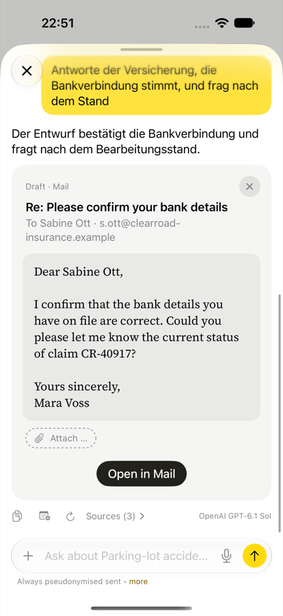

*12 s · $0.009*

<details><summary>Round 1, for comparison</summary>

```
Hello,

The bank details are correct. Could you please let me know the current status of the claim?

Best regards,
Mara Voss
```
</details>

### 17 · Accident, other driver

**Matter:** Parking-lot accident, 14 September · **In hand:** “what happened”

**You:** Schreib Tobias, dass der Gutachter am Montag kommt und ob er dabei sein will

<details><summary>What the bee was given about the mail in hand</summary>

```
E6 2026-10-25 from Tobias Lindqvist: Re: what happened — Tobias confirms he backed into the parked car. His insurer is Nordic Mutual. He asks to settle it quickly. — its words: "Hello Ms Voss, / Tobias confirms he backed into the parked car. His insurer is Nordic Mutual. He asks to settle it quickly. / Kind regards, / Tobias Lindqvist" — written: opens "Hello Ms Voss,", closes "Kind regards, / Tobias Lindqvist"
```
</details>

*Went out disguised as:* `Schreib [Person K], dass der Gutachter am Montag kommt und ob er dabei sein will`

> Der Entwurf kündigt den Gutachter für Montag an und fragt, ob er dabei sein möchte.  [E6 E2]

**Mail draft** · Subject: Re: what happened

```
Hello Mr Lindqvist,

The assessor is coming on Monday. Would you like to be there?

Kind regards,
Mara Voss
```
*Why, as the bee says:* Antwort auf Englisch, wie im bisherigen Austausch.

Checks: Their mail opens “Hello Ms Voss,”, closes “Kind regards, / Tobias Lindqvist” — the draft opens “Hello Mr Lindqvist,”, closes “Kind regards, / Mara Voss”. Language: theirs English, the draft English. Stand-ins left: none. Goes to: Tobias Lindqvist — Other driver (in 1 items). Greeting by first and last name — not as people write. Length: 19 words.

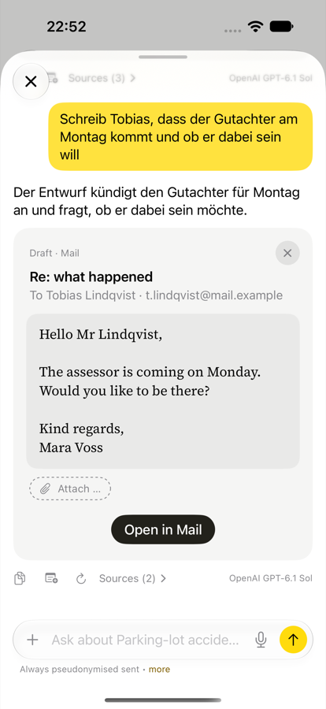

*7 s · $0.007*

<details><summary>Round 1, for comparison</summary>

```
Hallo,

der Gutachter kommt am Montag. Möchten Sie dabei sein?

Viele Grüße
Mara Voss
```
</details>

### 18 · Wedding, registry office (first contact)

**Matter:** Wedding, 12 June 2027 (Mara and Sam) · **In hand:** “Civil ceremony: documents”

**You:** Frag das Standesamt, ob die Geburtsurkunde auch als Kopie reicht

<details><summary>What the bee was given about the mail in hand</summary>

```
E2 2026-10-31 from Registry Office Kessel: Civil ceremony: documents — For the civil ceremony on 11 June both need ID, birth certificates and proof of residence. Bring them to a preparatory appointment. — its words: "Dear Ms Voss, / For the civil ceremony on 11 June both need ID, birth certificates and proof of residence. Bring them to a preparatory appointment. / Yours sincerely, / Registry Office Kessel" — written: opens "Dear Ms Voss,", closes "Yours sincerely, / Registry Office Kessel"
```
</details>

*Went out disguised as:* `Frag das Standesamt, ob die Geburtsurkunde auch als Kopie reicht`

> Der Entwurf fragt, ob eine Kopie der Geburtsurkunde ausreicht.  [E2]

**Mail draft** · Subject: Re: Civil ceremony: documents

```
Dear Sir or Madam,

Is a copy of the birth certificate sufficient?

Yours sincerely,
Mara Voss
```
*Why, as the bee says:* Das Standesamt verlangt Geburtsurkunden für den Vorbereitungstermin.

Checks: Their mail opens “Dear Ms Voss,”, closes “Yours sincerely, / Registry Office Kessel” — the draft opens “Dear Sir or Madam,”, closes “Yours sincerely, / Mara Voss”. Language: theirs English, the draft English. Stand-ins left: none. Goes to: Registry Office Kessel. Greeting by first and last name — not as people write. Length: 16 words.

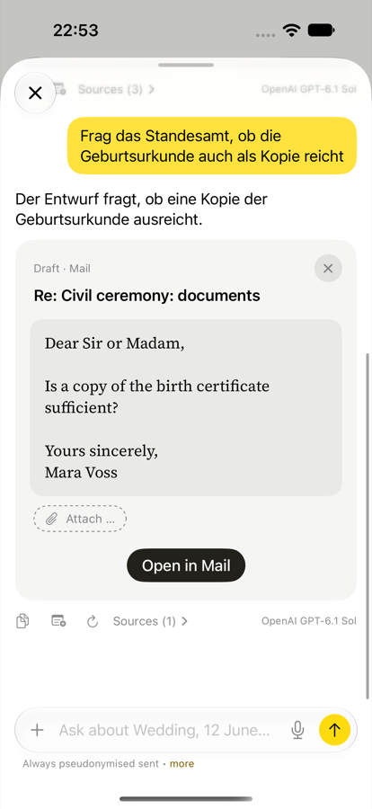

*6 s · $0.007*

<details><summary>Round 1, for comparison</summary>

```
Hallo,

reicht die Geburtsurkunde für den Vorbereitungstermin auch als Kopie?

Viele Grüße
Mara Voss
```
</details>

### 19 · Wedding, two vendors at once

**Matter:** Wedding, 12 June 2027 (Mara and Sam) · nothing in hand

**You:** Schreib Ravi und Jule, dass wir uns bis Ende des Monats entscheiden

*Went out disguised as:* `Schreib Ravi und Jule, dass wir uns bis Ende des Monats entscheiden`

> Zwei Mailentwürfe: Entscheidung über Fotograf und Band oder DJ jeweils bis Ende November.  [E5 E4]

**Mail draft** · Subject: Photography: decision by the end of November

```
Hello Ravi,

We’ll decide on the photographer by the end of November.

Kind regards,
Mara Voss
```
*Why, as the bee says:* Ravi bekommt die Rückmeldung zur Fotografenentscheidung bis Ende November.

Checks: Stand-ins left: none. Goes to: Ravi Nair — Photographer (in 1 items). Length: 16 words.

**Mail draft** · Subject: Live band or DJ: decision by the end of November

```
Hello Jule,

We’ll decide between a live band and a DJ by the end of November.

Kind regards,
Mara Voss
```
*Why, as the bee says:* Jule bekommt die Rückmeldung zur Entscheidung zwischen Band und DJ bis Ende November.

Checks: Stand-ins left: none. Goes to: Jule Brandt — Band leader (in 1 items). Length: 20 words.

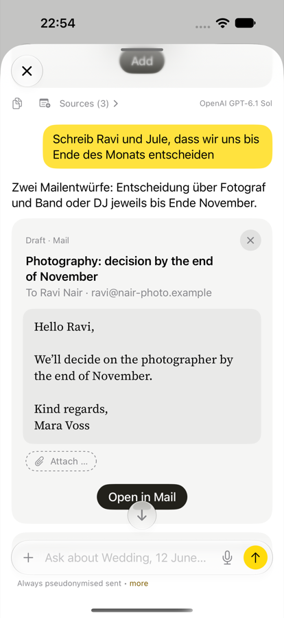

*15 s · $0.011*

<details><summary>Round 1, for comparison</summary>

```
Hallo Ravi,

wir entscheiden uns bis Ende November.

Viele Grüße
Mara Voss
```
```
Hallo Jule,

wir entscheiden uns bis Ende November.

Viele Grüße
Mara Voss
```
</details>

### 20 · Renovation, contractor with quote attached

**Matter:** Bathroom renovation · nothing in hand

**You:** Mail an Oskar: Angebot passt, Anzahlung kommt diese Woche. Häng das Angebot mit dran.

*Went out disguised as:* `Mail an Oskar: Angebot passt, Anzahlung kommt diese Woche. Häng das Angebot mit dran.`

> Mail an Oskar auf Englisch, mit dem Angebot im Anhang.  [P2 E7 F3]

**Mail draft** · Subject: Bathroom renovation: quote

```
Hello Mr Lenz,

The quote works for me. The deposit will follow this week.

Kind regards,
Mara Voss
```
*Why, as the bee says:* Bestätigt Oskar das Angebot und kündigt die Anzahlung für diese Woche an; das Angebot ist angehängt.

Checks: Stand-ins left: none. Goes to: Oskar Lenz — Builder, Lenz Bau (in 2 items). Greeting by first and last name — not as people write. Takes along: Quote-Lenz-Bau.pdf. Length: 18 words.

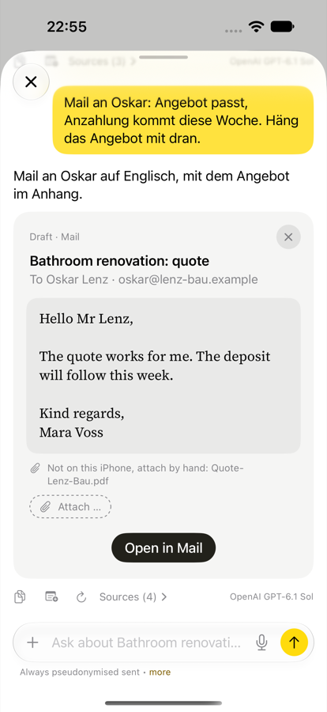

*9 s · $0.007*

<details><summary>Round 1, for comparison</summary>

```
Hallo,

das Angebot passt. Die Anzahlung kommt diese Woche.

Viele Grüße
Mara Voss
```
</details>

### 21 · Renovation, plumber short message

**Matter:** Bathroom renovation · nothing in hand

**You:** SMS an Mia: kannst du Mittwoch statt Dienstag?

*Went out disguised as:* `SMS an [Person L]: kannst du Mittwoch statt Dienstag?`

**Short message**

```
Can you do Wednesday instead of Tuesday?
```
*Why, as the bee says:* Die bisherige Korrespondenz ist auf Englisch.

Checks: Stand-ins left: none. Goes to: Mia Vogel — Plumber (in 1 items). Length: 7 words.

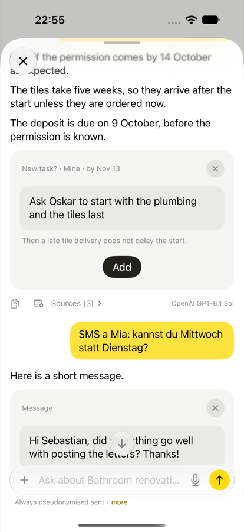

*8 s · $0.007*

<details><summary>Round 1, for comparison</summary>

```
Kannst du Mittwoch statt Dienstag?
```
</details>

### 22 · Science fair, other parent

**Matter:** Science fair: rainwater filter (Noa, 9b) · **In hand:** “Deniz has the flu”

**You:** Antworte Elif: klar, Samstag ab 10 bei uns, Werkzeug ist da

<details><summary>What the bee was given about the mail in hand</summary>

```
E3 2026-11-05 from Elif Demir: Deniz has the flu: can we build at yours on Saturday? — Deniz is ill, but can join on Saturday afternoon. Elif asks if the group can build at Mara's place, because of the garden tap. — its words: "Hi Mara! / Deniz is ill, but can join on Saturday afternoon. Elif asks if the group can build at Mara's place, because of the garden tap. / See you soon, / Elif" — written: opens "Hi Mara!", closes "See you soon, / Elif"
```
</details>

*Went out disguised as:* `Antworte Elif: klar, Samstag ab 10 bei uns, Werkzeug ist da`

**Mail draft** · Subject: Re: Deniz has the flu: can we build at yours on Saturday?

```
Hi Elif!

Sure, Saturday from 10 at ours works. We have the tools here.

See you soon,
Mara
```
*Why, as the bee says:* Antwort auf Elifs Anfrage mit deiner Zusage und dem Hinweis zum Werkzeug.

Checks: Their mail opens “Hi Mara!”, closes “See you soon, / Elif” — the draft opens “Hi Elif!”, closes “See you soon, / Mara”. Language: theirs English, the draft English. Stand-ins left: none. Goes to: Elif Demir — Parent of Deniz, in the group (in 3 items). Length: 18 words.

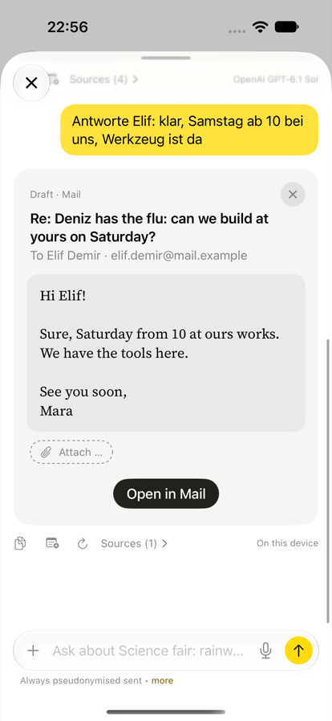

*9 s · $0.009*

<details><summary>Round 1, for comparison</summary>

```
Hallo Elif Demir,

klar, Samstag ab 10 Uhr bei uns. Werkzeug ist da.

Viele Grüße
Mara Voss
```
</details>

### 23 · Meticulous, rewrite

**Matter:** Moving to Birch Road 12 · **In hand:** “Parking for the van”

**You:** Antworte Frau Adler wegen dem Parkplatz: Samstag 8 bis 12 Uhr

<details><summary>What the bee was given about the mail in hand</summary>

```
E1 2026-11-08 from Ms. Adler: Parking for the van? — Ms. Adler from Birch Road 10 says the van can use her drive on Wednesday morning if asked in time. — its words: "Hello Ms Voss, / Ms. Adler from Birch Road 10 says the van can use her drive on Wednesday morning if asked in time. / Kind regards, / Ms. Adler" — written: opens "Hello Ms Voss,", closes "Kind regards, / Ms. Adler"
```
</details>

*Went out disguised as:* `Antworte Frau [Person D] wegen dem Parkplatz: Samstag 8 bis 12 Uhr`

**Mail draft** · Subject: Re: Parking for the van?

```
Hello Ms Adler,

Could we use your drive for the van on Saturday from 8:00 to 12:00?

Kind regards,
Mara Voss
```
*Why, as the bee says:* Fragt nach dem Parkplatz für Samstag von 8 bis 12 Uhr statt Mittwochvormittag.

Checks: Their mail opens “Hello Ms Voss,”, closes “Kind regards, / Ms. Adler” — the draft opens “Hello Ms Adler,”, closes “Kind regards, / Mara Voss”. Language: theirs English, the draft English. Stand-ins left: none. Goes to: Ms. Adler. Greeting by first and last name — not as people write. Length: 21 words.

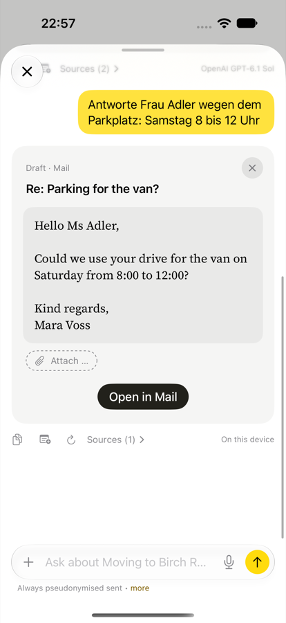

*9 s · $0.008*

**You:** mach Sie draus, nicht du

*Went out disguised as:* `mach Sie draus, nicht du`

> Mit förmlicher Anrede; im Englischen bleibt es bei „you“.  [E1]

**Mail draft** · Subject: Re: Parking for the van?

```
Hello Ms Adler,

Could we use your drive for the van on Saturday from 8:00 to 12:00?

Kind regards,
Mara Voss
```
*Why, as the bee says:* Förmliche Anrede, passend zum englischen Mailwechsel.

Checks: Their mail opens “Hello Ms Voss,”, closes “Kind regards, / Ms. Adler” — the draft opens “Hello Ms Adler,”, closes “Kind regards, / Mara Voss”. Language: theirs English, the draft English. Stand-ins left: none. Goes to: Ms. Adler. Greeting by first and last name — not as people write. Length: 21 words.

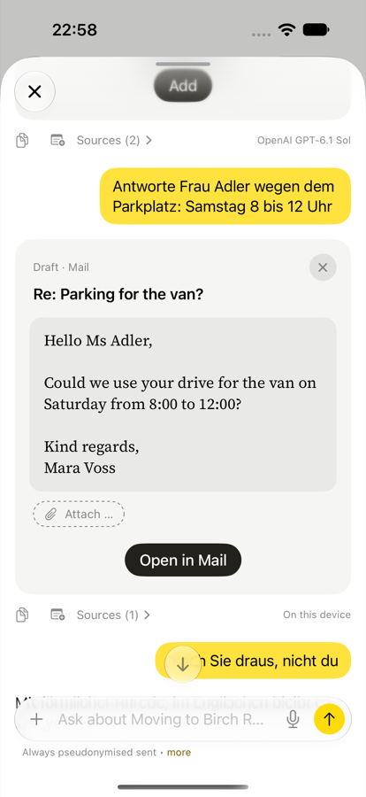

*11 s · $0.009*

**You:** und unterschreib nur mit Mara

*Went out disguised as:* `und unterschreib nur mit [Place A]`

**Mail draft** · Subject: Re: Parking for the van?

```
Hello Ms Adler,

Could we use your drive for the van on Saturday from 8:00 to 12:00?

Kind regards,
Mara
```
*Why, as the bee says:* Gleicher Entwurf, nur mit Mara unterschrieben.

Checks: Their mail opens “Hello Ms Voss,”, closes “Kind regards, / Ms. Adler” — the draft opens “Hello Ms Adler,”, closes “Kind regards, / Mara”. Language: theirs English, the draft English. Stand-ins left: none. Goes to: Ms. Adler. Greeting by first and last name — not as people write. Length: 20 words.

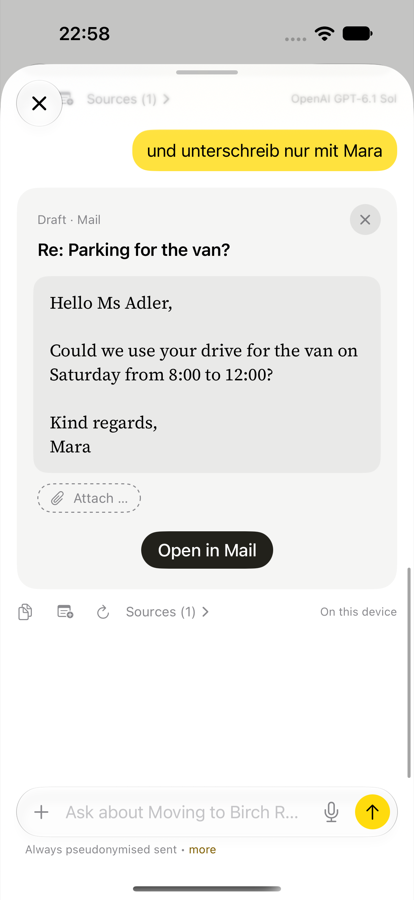

*4 s · $0.006*

<details><summary>Round 1, for comparison</summary>

```
Hallo Frau Adler,

können wir Ihre Einfahrt am Samstag von 8 bis 12 Uhr für den Umzugswagen nutzen?

Viele Grüße
Mara Voss
```
```
Hallo Frau Adler,

können wir Ihre Einfahrt am Samstag von 8 bis 12 Uhr für den Umzugswagen nutzen?

Viele Grüße
Mara Voss
```
```
Hallo Frau Adler,

können wir Ihre Einfahrt am Samstag von 8 bis 12 Uhr für den Umzugswagen nutzen?

Viele Grüße
Mara Voss
```
</details>

### 24 · Christmas dinner, restaurant

**Matter:** Christmas dinner with friends · **In hand:** “Your table on the 20th”

**You:** Bestätige den Tisch für 8, eine Person vegetarisch

<details><summary>What the bee was given about the mail in hand</summary>

```
E1 2026-11-06 from Trattoria Lume: Your table on the 20th — Table for 6 on the 20th at 19:30 is held until Friday; please confirm the number of guests. — its words: "Hello Ms Voss, / Table for 6 on the 20th at 19:30 is held until Friday; please confirm the number of guests. / Kind regards, / Trattoria Lume" — written: opens "Hello Ms Voss,", closes "Kind regards, / Trattoria Lume"
```
</details>

*Went out disguised as:* `Bestätige den Tisch für 8, eine Person vegetarisch`

> Der Mailentwurf bestätigt den Tisch für acht Personen, davon eine vegetarisch.  [E1 A1]

**Mail draft** · Subject: Re: Your table on the 20th

```
Hello,

I'd like to confirm the table for 8 on 20 November at 19:30. One person is vegetarian.

Kind regards,
Mara Voss
```
*Why, as the bee says:* Bestätigt den Tisch für acht Personen und nennt eine vegetarisch essende Person.

Checks: Their mail opens “Hello Ms Voss,”, closes “Kind regards, / Trattoria Lume” — the draft opens “Hello,”, closes “Kind regards, / Mara Voss”. Language: theirs English, the draft English. Stand-ins left: none. Goes to: Trattoria Lume — Restaurant (in 1 items). Length: 22 words.

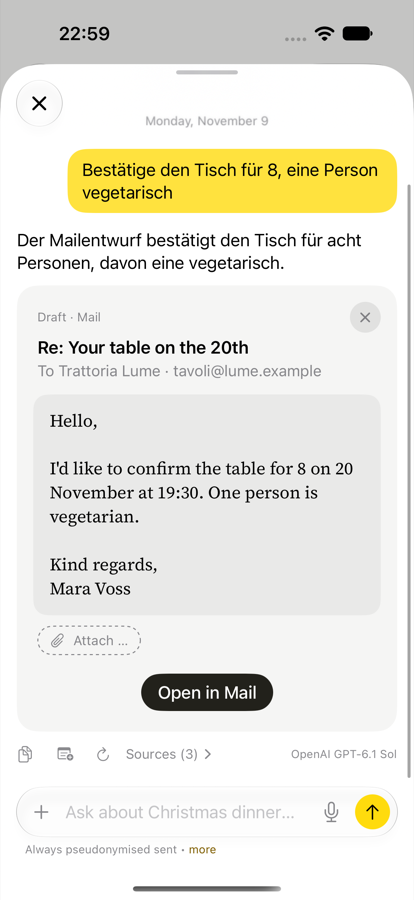

*8 s · $0.005*

<details><summary>Round 1, for comparison</summary>

```
Hello,

I'd like to confirm the table on 20 November at 19:30 for 8 people. One person is vegetarian.

Best regards,
Mara Voss
```
</details>

## What is still open

- The model does not always pick the greeting the rules ask for: “Hello,” to Priya (a person, who writes “Hello Ms Voss”), “Dear Sabine Ott”, “Hello Ravi” where “Hello Mr Nair” mirrors him. Rare, and the owner sees every draft before it goes; a check after the answer could correct it.
- The model does not always pick the greeting the rules ask for: “Hello,” to Priya (a person, who writes “Hello Ms Voss”), “Dear Sabine Ott”, “Hello Ravi” where “Hello Mr Nair” mirrors him. Rare, and the owner sees the draft before it goes; a check after the answer could correct it.
- The demo writes its mails in English while the owner asks in German; real mail is mostly German. The rules are the same; a German demo round would show German registers (du/Sie).
- A draft goes to one person. Writing “to everyone” in a group gives a short message for the chat, or one draft each (case 19); a mail to several at once is not offered yet.
- Attaching works by the file's name (cases 10, 20). In the demo the files do not exist, so the card says “Not on this iPhone, attach by hand”; with real mail the file is fetched from it first.
- A link (the portfolio, case 12) is never sent to the bee, so it asks for it rather than guessing — by design (privacy), but the owner has it already.
